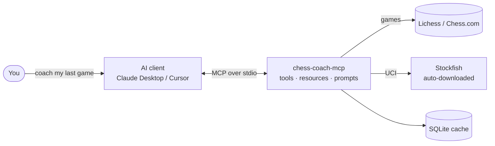
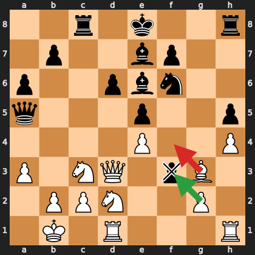

# Chess Coach MCP

An open-source [MCP](https://modelcontextprotocol.io) server that turns any AI assistant
(Claude Desktop, Cursor, Claude Code, ...) into a chess coach. It fetches your games from
**Lichess** or **Chess.com**, runs them through **Stockfish**, and hands the AI structured
ground truth so it can explain *why* you lost, in plain language.

> "The game was decided by one move: 18. Bf4. It hung the bishop to the e5 pawn, and it
> ignored the pawn on f3, which took on g2, hit your rook and threatened to promote.
> 18. gxf3 was the safe move. Lesson: when a pawn lands next to your king, deal with it
> before anything else."

That paragraph is from a real game. See the [complete worked example](docs/EXAMPLE.md)
and the [idea, flow and UI write-up](docs/IDEA.md).

## How it flows



1. You ask for coaching. The AI calls `get_recent_games`, then `analyze_game`.
2. The server fetches the PGN, runs every position through Stockfish, labels each move
   (best / good / inaccuracy / mistake / blunder) and returns JSON with the critical
   moments and their positions.
3. The AI explains the mistakes in words and gives you one lesson. Follow-up questions are
   instant because the report is cached.



## Why

| Today's option        | What's wrong                                        |
|-----------------------|-----------------------------------------------------|
| Chess.com Game Review | Limited free uses per day, full version is paid     |
| Lichess analysis      | Free, but only shows numbers (`?? -3.2`), no words  |
| Human coach           | Explains properly, but expensive                    |

Engines tell you *what* was wrong. Coaches tell you *why*. The hard part, explaining chess
in natural language, is exactly what an LLM is good at. This server gives the LLM the data
(your games) and the ground truth (engine evaluations) and gets out of the way.

## What you can ask

- "Coach me through my last game." (one game, three biggest mistakes, one lesson)
- "What should I have played instead of 23...Qxb2?"
- "Give me a weekly review. What keeps going wrong?"
- "Which openings do I lose most with as Black?"
- "Show me another game where I hung a piece to a fork."

## Install

Requirements: Python 3.11+. Stockfish is optional: on first analysis the server downloads the
official Stockfish release for your OS into its cache directory. If that is not possible it
falls back to Lichess cloud evaluations (partial coverage).

```bash
pip install chess-coach-mcp
# or, from a clone:
pip install -e .
```

### Claude Desktop

Add this to `claude_desktop_config.json` (see `examples/claude_desktop_config.json`):

```json
{
  "mcpServers": {
    "chess-coach": {
      "command": "chess-coach-mcp"
    }
  }
}
```

### Claude Code

```bash
claude mcp add chess-coach -- chess-coach-mcp
```

### Any other MCP client

Run `chess-coach-mcp` as a stdio server. No hosting, no API keys.

## Configuration (all optional)

| Environment variable        | Default                                   | Meaning                                              |
|-----------------------------|-------------------------------------------|------------------------------------------------------|
| `STOCKFISH_PATH`            | auto-detect                               | Path to a Stockfish binary                           |
| `CHESS_COACH_AUTO_DOWNLOAD` | `1`                                       | Download Stockfish automatically if none is found    |
| `CHESS_COACH_CACHE_DIR`     | `~/.cache/chess-coach-mcp` (`%LOCALAPPDATA%` on Windows) | Where games, reports and the engine are stored |
| `CHESS_COACH_DEFAULT_DEPTH` | `14`                                      | Search depth for the first pass over every move      |
| `CHESS_COACH_REFINE_DEPTH`  | `18`                                      | Depth used to double-check suspicious moves          |
| `CHESS_COACH_TIME_PER_POSITION` | `0.5`                                 | Max seconds per position in the first pass           |
| `CHESS_COACH_REFINE_TIME_PER_POSITION` | `2.0`                          | Max seconds per position when double-checking        |
| `CHESS_COACH_ENGINE_THREADS`| half your cores (1-4)                     | Stockfish threads                                    |
| `CHESS_COACH_ENGINE_HASH`   | `128`                                     | Stockfish hash table in MB                           |
| `LICHESS_TOKEN`             | none                                      | Personal API token for higher Lichess rate limits    |

## MCP surface

### Tools

| Tool                | Input                                                   | Returns                                                                 |
|---------------------|---------------------------------------------------------|-------------------------------------------------------------------------|
| `get_recent_games`  | `username`, `platform` (lichess/chesscom), `count`      | game ids, opponent, your result, opening, date                          |
| `analyze_game`      | `game_id`, `platform?`, `username?`, `depth?`           | per-move evals, cp loss, labels, best line, accuracy, critical moments  |
| `find_blunders`     | `game_id`, `platform?`, `username?`, `threshold?`, `only_user?` | only the moves that lost >= threshold cp, with FEN and best line |
| `get_opening_stats` | `username`, `platform?`, `color?`, `count?`              | win/draw/loss per opening, weakest openings                             |
| `engine_status`     |                                                         | which engine is in use and cache statistics                             |

Game ids can be bare (`abcd1234`, `123456789`) or full URLs from either site.

### Resources

| URI                                          | Content                                     |
|----------------------------------------------|---------------------------------------------|
| `chess://games/{username}/recent`            | JSON list of recent Lichess games           |
| `chess://{platform}/games/{username}/recent` | JSON list of recent games on a platform     |
| `chess://game/{game_id}/pgn`                 | Raw PGN (platform guessed from the id)      |
| `chess://{platform}/game/{game_id}/pgn`      | Raw PGN                                     |

### Prompts

| Prompt               | Arguments              | What it does                                                        |
|----------------------|------------------------|---------------------------------------------------------------------|
| `coach_my_last_game` | `username`, `platform` | Fetch + analyze your last game, explain the 3 biggest mistakes      |
| `weekly_review`      | `username`, `platform` | Analyze the last 7 days, find recurring patterns behind your losses |

## How the analysis works

1. The game's PGN is fetched (and cached in SQLite).
2. Every position is evaluated by Stockfish at depth 14 (capped at half a second each).
   Evaluations are clamped to +/-1000 centipawns so that "+15 to +9" in a won position
   is not counted as a blunder.
3. For each move, centipawn loss = how much the mover's evaluation dropped compared with
   the engine's best move. Moves are labelled:

   | Centipawn loss | Label       |
   |----------------|-------------|
   | > 300          | blunder     |
   | 100 - 300      | mistake     |
   | 50 - 100       | inaccuracy  |
   | otherwise      | good / best |

4. Suspicious moves are re-checked at depth 18 (up to two seconds each) so shallow false
   positives disappear. A 40-move game takes roughly 30-60 seconds the first time.
5. Per-player accuracy uses the Lichess formula. The report (JSON) is cached, so asking
   follow-up questions about the same game is instant.

## Design notes

- **`core/` has zero MCP imports.** Tools, resources and prompts are thin wrappers over it.
  The chess logic is testable without an MCP client and reusable from a CLI or web app.
- **Tools, resources and prompts are separate packages.** The server uses all three MCP
  primitives, not just tool calling.
- **Engine access is pluggable.** `StockfishEngine` (local UCI subprocess) and
  `LichessCloudEngine` (HTTP) implement the same two-method protocol, and tests use a fake.
- **Everything is cached.** Games and reports are stored in SQLite keyed by game id, depth
  and engine, so repeated questions never re-run the engine.

## Project layout

```
src/chess_coach_mcp/
├── server.py        # builds the MCPServer, registers everything, runs stdio
├── services.py      # shared cache / HTTP / engine instances, game resolution
├── config.py        # environment-driven settings
├── tools/           # get_recent_games, analyze_game, find_blunders, get_opening_stats
├── resources/       # chess://games/..., chess://game/.../pgn
├── prompts/         # coach_my_last_game, weekly_review
├── core/            # engine.py, analysis.py, cache.py, models.py, pgn.py  (no MCP imports)
└── clients/         # lichess.py, chesscom.py
tests/               # unit tests with a fake engine and mocked HTTP
```

## Documentation

- [docs/IDEA.md](docs/IDEA.md): the idea, the system flow, what the UI looks like, data shape.
- [docs/EXAMPLE.md](docs/EXAMPLE.md): one real game, start to finish, tool calls and coaching.
- [docs/PLAN.md](docs/PLAN.md): the original project plan this was built from.

## Development

```bash
git clone https://github.com/deven1003/chess-coach-mcp
cd chess-coach-mcp
pip install -e ".[dev]"
ruff check . && ruff format --check .
pytest
```

Try the server interactively with the MCP inspector:

```bash
npx @modelcontextprotocol/inspector chess-coach-mcp
```

## Roadmap

- [x] v1: Lichess + Chess.com games, Stockfish analysis, blunder classification, prompts
- [ ] v1.2: multi-game pattern detection (recurring tactical motifs, tagged automatically)
- [ ] v2: puzzle suggestions from the Lichess puzzle database based on your weaknesses
- [ ] v2: opening repertoire recommendations via the Lichess opening explorer

## License

MIT
