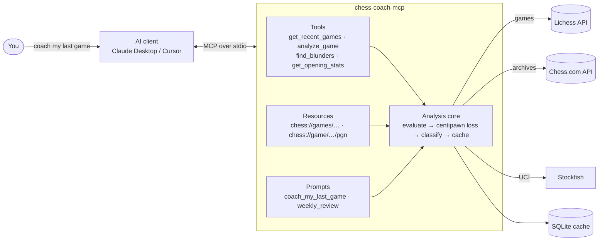

# ♟️ Chess Coach MCP

**An MCP server that turns any AI assistant into a chess coach**

It fetches your games from Lichess or Chess.com, analyzes every move with Stockfish,
and gives the AI the ground truth it needs to explain *why* you lost, in plain language.

*Built by **Deven Kalathiya***

A real Lichess blitz game. White played <b>18. Bf4</b> (red). The bishop hangs to the e5 pawn, and the
pawn on f3 takes on g2 next, hitting the rook and threatening to promote. Stockfish wanted <b>18. gxf3</b> (green).

> **The coach's verdict:** "The game was decided by one move: 18. Bf4. It hung the bishop and ignored the pawn
> on f3. 18. gxf3 was the safe move. Lesson: when a pawn lands next to your king, deal with it before anything else."

---

## 📌 The problem

| Today's option | What's wrong |
|---|---|
| ❌ Chess.com Game Review | Limited free uses per day; the full version is paid |
| ❌ Lichess analysis | Free, but only shows numbers (`?? -3.2`), never *why* |
| ❌ Human coach | Explains properly, but expensive and needs scheduling |

**Engines tell you *what* was wrong. Coaches tell you *why*.** Only the expensive option explains it in words
you can learn from.

## 💡 The idea

Explaining chess in natural language is exactly what an LLM is good at. What it lacks is ground truth: it cannot
calculate variations reliably. So the work is split:

| | Who | What |
|---|---|---|
| 🐟 **Stockfish** | runs locally, auto-downloaded | evaluates every position, finds the best move and line |
| 🔌 **This MCP server** | Python, no hosting, no API keys | fetches the games, runs the engine, labels every move, returns clean JSON |
| 🤖 **The AI client** | Claude Desktop, Cursor, Claude Code | reads the JSON and coaches: names the motif, says what to play, gives one lesson |

Users add one line to their client's config. No website, no account, no paid API: Lichess, Chess.com and
Stockfish are all free.

---

## 🔁 How it flows

1. You pick **Coach my last game** in the client and type your username.
2. The AI calls `get_recent_games`, then `analyze_game`. You see a progress bar while Stockfish works
   (about 10 to 40 seconds for a full game).
3. The server returns every move's evaluation, a label (best / good / inaccuracy / mistake / blunder), the engine's
   best line, per-player accuracy, and the critical moments **with their exact position (FEN)**.
4. The AI explains the three biggest mistakes and gives you one lesson. Follow-up questions
   ("what should I have played instead?") are instant because the report is cached.

👉 **[Read the complete worked example](docs/EXAMPLE.md)**, start to finish, with the real tool calls and the
real coaching answer. **[Read the idea, flow and UI write-up](docs/IDEA.md)** for the design.

---

## 🧰 What the AI gets to use

All three MCP primitives, not just tool calling.

### Tools

| Tool | Input | Returns |
|---|---|---|
| `get_recent_games` | username, platform (lichess / chesscom), count | game ids, opponent, your result, opening, date |
| `analyze_game` | game id or URL, username | per-move evals, labels, best lines, accuracy, critical moments with FEN |
| `find_blunders` | game id, username, threshold | only the moves that lost material, worst first |
| `get_opening_stats` | username, colour | win / draw / loss per opening, your weakest openings |
| `engine_status` | | which engine is running and cache statistics |

### Resources

| URI | Content |
|---|---|
| `chess://games/{username}/recent` | JSON list of recent games |
| `chess://game/{game_id}/pgn` | raw PGN (platform guessed from the id) |

### Prompts

| Prompt | What it does |
|---|---|
| `coach_my_last_game` | fetch + analyze your last game, explain the 3 biggest mistakes, one lesson |
| `weekly_review` | analyze the last 7 days, find the recurring patterns behind your losses |

---

## 🔬 How the analysis works

| Centipawn loss | Label |
|---|---|
| more than 300 | blunder |
| 100 to 300 | mistake |
| 50 to 100 | inaccuracy |
| less than 50 | good / best |

- Every position goes through Stockfish at depth 14, capped at half a second each.
- Evaluations are clamped to ±10 pawns, so "winning more slowly" in a crushed position is not a blunder.
- Suspicious moves are re-checked at depth 18, so shallow false positives disappear.
- Accuracy uses the Lichess formula. Games and reports are cached in SQLite, keyed by game, depth and engine.
- If Stockfish cannot be downloaded, the server falls back to Lichess cloud evaluations and says so in the report.

---

## 💬 Example conversations

| You type | What happens |
|---|---|
| "Coach me through my last game" | Fetches it, analyzes it, explains the 3 worst moves and gives one lesson |
| "What should I have played on move 18?" | Answers from the cached report, with the engine's line |
| "Which openings do I lose most with as Black?" | `get_opening_stats`, grouped by opening family |
| "Give me a weekly review" | Analyzes every loss from the last 7 days and names the recurring motif |
| "Show me another game where I hung a piece" | Scans recent games' blunders for the same pattern |

---

## 🔒 Source code

This repository is a showcase of the project. The source code is kept private.
If you'd like a live demo or a walkthrough of the code, feel free to reach out.

---

## 🧩 Design decisions

- **The chess core has zero MCP imports.** Tools, resources and prompts are thin wrappers over it, so the
  analysis is testable without an MCP client and reusable from a CLI or a web app.
- **Pluggable engine.** Local Stockfish and the Lichess cloud fallback implement the same two-method protocol;
  tests use a deterministic fake, so the whole MCP surface is tested in-process in under 3 seconds.
- **Ground truth, not opinions.** The server never explains anything. It returns numbers, labels and positions;
  the explaining is left to the model, which is what it is good at.
- **Errors the model can act on.** Anticipated failures (unknown user, rate limit, missing engine) reach the AI as
  readable messages instead of a generic "tool failed".
- **Bounded time.** Per-position time caps keep a 90-move game to about a minute instead of several.

## 🔭 Roadmap

Motif tagging across games (hanging piece, fork, back-rank, time pressure), puzzle suggestions from the Lichess
puzzle database matched to your weak motifs, and opening repertoire advice from the Lichess opening explorer.

## 🛠️ Tech

Python 3.11+ · official `mcp` SDK 2.x · `python-chess` · `httpx` · SQLite · Stockfish 19 · pytest + ruff ·
GitHub Actions on Linux, Windows and macOS

---

Built by <b>Deven Kalathiya</b>

