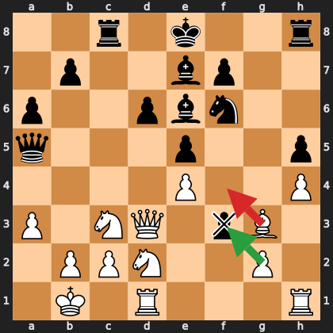

# A complete example

Everything below comes from a real, public Lichess blitz game
([lichess.org/J3C5rR4Z](https://lichess.org/J3C5rR4Z), 3+0, Sicilian Defense: Moscow
Variation, 14 October 2026) analyzed by this server with Stockfish 19. The tool output is
the server's real JSON, trimmed for length. The coaching text is what the AI produces from
it. For the example, the user is playing White.

---

### You

> Coach me through my last game. I was White.

### Claude → `get_recent_games`

```json
{"username": "…", "platform": "lichess", "count": 1}
```

```json
{
  "games": [{
    "game_id": "J3C5rR4Z",
    "date": "2026-10-14T18:00:01+00:00",
    "user_color": "white",
    "user_result": "loss",
    "opponent": {"name": "…", "rating": 3153},
    "opening": "Sicilian Defense: Moscow Variation",
    "eco": "B51",
    "speed": "blitz",
    "time_control": "180+0",
    "moves_played": 36,
    "termination": "resign",
    "url": "https://lichess.org/J3C5rR4Z"
  }]
}
```

### Claude → `analyze_game`

```json
{"game_id": "J3C5rR4Z", "username": "…"}
```

Nine seconds later (92 positions at depth 14, two re-checked at depth 18):

```json
{
  "engine": "stockfish", "depth": 14, "refine_depth": 18,
  "white": {"moves": 18, "best": 11, "inaccuracies": 0, "mistakes": 0, "blunders": 1,
            "average_cp_loss": 48.6, "accuracy": 80.0},
  "black": {"moves": 18, "best": 12, "inaccuracies": 0, "mistakes": 0, "blunders": 0,
            "average_cp_loss": 3.4, "accuracy": 89.3},
  "critical_moments": [{
    "move": "18. Bf4", "color": "white", "classification": "blunder",
    "eval_before": 30, "eval_after": -762, "cp_loss": 792,
    "best_move": "gxf3", "best_line": ["gxf3", "Rg8"],
    "fen_before": "2r1k2r/1p2bp2/p2pbn2/q3p2p/4P2P/P1NQ1pB1/1PPN2P1/1K1R3R w k - 0 18"
  }],
  "moves": [
    {"move": "1. e4",    "classification": "best", "cp_loss": 0},
    {"move": "1... c5",  "classification": "good", "cp_loss": 15},
    "…",
    {"move": "17. f4",   "classification": "best", "cp_loss": 0},
    {"move": "17... gxf3", "classification": "best", "cp_loss": 0},
    {"move": "18. Bf4",  "classification": "blunder", "cp_loss": 792, "best_move": "gxf3"},
    {"move": "18... fxg2", "classification": "best", "cp_loss": 0}
  ],
  "notes": []
}
```

### The position before 18. Bf4

White to move. Red arrow: what was played. Green arrow: what Stockfish wanted.



### Claude (the coach)

> **Result.** You lost with White in 18 moves in a Sicilian, Moscow Variation (3. Bb5+).
> Until move 17 you were doing fine: the engine calls your position roughly equal, and
> eleven of your eighteen moves were the engine's first choice.
>
> **The game was decided by one move: 18. Bf4.**
>
> One move earlier you played 17. f4, a reasonable attempt to open the centre, and your
> opponent answered 17...gxf3, taking *en passant*. That left a black pawn sitting on f3,
> right in front of your g2 pawn. That pawn was the whole story of the position: it had
> to be dealt with immediately.
>
> Instead, 18. Bf4 did two bad things at once:
>
> 1. **It hung the bishop.** f4 is attacked by the pawn on e5, so Black can simply take it.
> 2. **It ignored the f3 pawn.** Black did not even need the bishop. After 18...fxg2 the
>    pawn attacks your rook on h1 and is one step from promoting on g1. You cannot save the
>    rook and stop the promotion and rescue the bishop all at once.
>
> The engine evaluation swung from about +0.3 (equal) to -7.6, which is a lost position.
> You resigned a few moves later.
>
> **What to play instead: 18. gxf3.** Just take the pawn back. The structure is a bit loose
> but material stays level, your rooks keep the open g-file, and the position is roughly
> equal. It is not a brilliant move, it is a *safe* one, and in a 3-minute game safe is
> what wins.
>
> **The lesson.** When a pawn lands next to your king, deal with it before anything else.
> Before you move a piece, ask one question: "is the square I am going to attacked?"
> Bf4 fails that test by itself; the f3 pawn turned a small slip into a lost game.
>
> **One habit to practise this week:** after every opponent move, say out loud (or in your
> head) what it *threatens* before you look at what *you* want to do.

### You

> Why is gxf3 better than Nxf3? My knight on d2 could take.

### Claude → `find_blunders`

```json
{"game_id": "J3C5rR4Z", "username": "…", "threshold": 0}
```

Instant, because the report is cached.

> Good question. 18. Nxf3 also removes the pawn, but it moves the knight away from d2 and
> leaves your e4 pawn with one defender fewer; more importantly, after 18...Nxe4 the knight
> on c3 is attacked and Black's pieces flood in. The engine's line keeps the knight on d2
> as a defender and uses the g-pawn to capture, so that your rook on h1 looks straight down
> the half-open g-file at Black's king. The difference is about half a pawn: both moves keep
> you in the game, but gxf3 keeps every defender where it was. Bf4 is the only move that
> actually loses.

---

## Why this is more useful than an engine line

Lichess would show you `18. Bf4?? (+0.3 → -7.6)` and the line `18. gxf3`. What it will not
tell you is *that the pawn on f3 was the point*, *that Bf4 hung a piece*, or *that the
habit to fix is checking threats first*. Those sentences are the coaching, and they are
what the AI adds on top of the server's ground truth.
