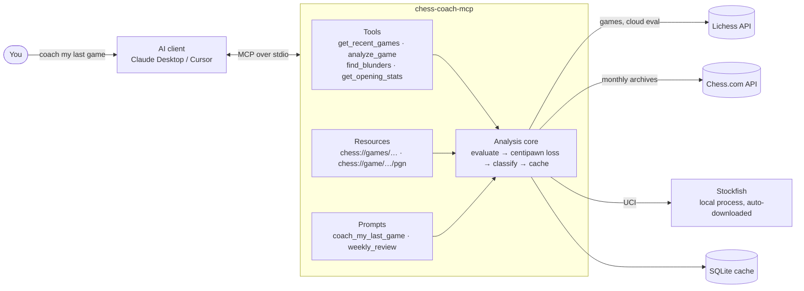
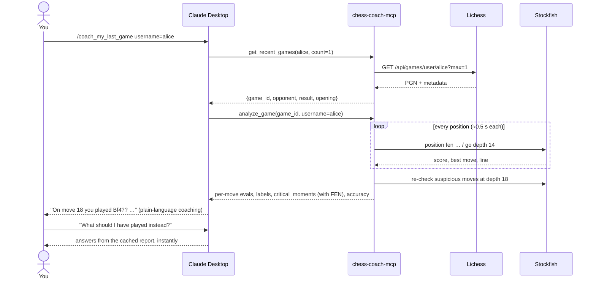

# Chess Coach MCP: idea, flow and UI

## The idea in one line

Give an AI assistant your online chess games plus Stockfish's verdict on every move, so it
can explain **why** you lost in plain language, for free, inside the chat app you already use.

## The problem

| What people use today  | Where it falls short                                      |
|------------------------|-----------------------------------------------------------|
| Chess.com Game Review  | Only a few free reviews per day; the full version is paid |
| Lichess analysis       | Free, but only shows `?? -3.2`; it never says *why*       |
| A human coach          | Explains properly, but costs money and needs scheduling   |

Engines know *what* was wrong. Coaches explain *why*. The gap is "free and explains why".

## The insight

Explaining chess in natural language is exactly what an LLM is good at. What it lacks is
ground truth: it cannot calculate variations reliably. So the split is:

- **Stockfish** supplies the truth: evaluation of every position, the best move, the best line.
- **The MCP server** fetches the games, runs the engine, labels every move
  (best / good / inaccuracy / mistake / blunder) and hands the AI clean JSON.
- **The AI** turns that into coaching: names the motif, says what to play instead, and
  gives one lesson to practise.

No website, no hosting, no account. Users install one package and add one line to their
Claude Desktop (or Cursor, or Claude Code) config.

## System flow



## What happens when you say "coach my last game"



## Move labelling

| Centipawn loss (how much worse your position got vs. the best move) | Label       |
|----------------------------------------------------------------------|-------------|
| more than 300                                                        | blunder     |
| 100 to 300                                                           | mistake     |
| 50 to 100                                                            | inaccuracy  |
| less than 50                                                         | good / best |

Evaluations are clamped to ±10 pawns so that "winning more slowly" in a crushed position
is not counted as a blunder. Suspicious moves get a second, deeper look so cheap false
positives disappear.

## The UI

There is no app to open. The user interface is the chat you already have. Three things
appear in it:

**1. The prompt picker.** In Claude Desktop the two prompts show up in the "+" menu as
*Coach my last game* and *Weekly review*. Pick one, type your username, done.

**2. Tool cards.** While the AI works you see collapsible cards for each call:

```
▸ get_recent_games   username="alice"  count=1           0.4 s
▸ analyze_game       game_id="J3C5rR4Z" username="alice"  9.1 s   ████████░░ 86/92
```

The second card shows live progress, because the server reports it per position.

**3. The coaching answer.** Plain prose, one idea per mistake, one lesson at the end.
See [EXAMPLE.md](EXAMPLE.md) for a complete, real transcript.

For developers there is also the MCP Inspector (`npx @modelcontextprotocol/inspector
chess-coach-mcp`), a web page that lists every tool, resource and prompt and lets you call
them with a form.

## What the AI receives (shape of the data)

```json
{
  "game": {"game_id": "J3C5rR4Z", "user_color": "white", "user_result": "loss",
           "opening": "Sicilian Defense: Moscow Variation", "speed": "blitz"},
  "white": {"accuracy": 80.0, "blunders": 1, "mistakes": 0, "inaccuracies": 0},
  "black": {"accuracy": 89.3, "blunders": 0, "mistakes": 0, "inaccuracies": 0},
  "critical_moments": [
    {"move": "18. Bf4", "classification": "blunder", "cp_loss": 792,
     "eval_before": 30, "eval_after": -762,
     "best_move": "gxf3", "best_line": ["gxf3", "Rg8"],
     "fen_before": "2r1k2r/1p2bp2/p2pbn2/q3p2p/4P2P/P1NQ1pB1/1PPN2P1/1K1R3R w k - 0 18"}
  ],
  "moves": ["… one compact entry per move …"]
}
```

The FEN is the key: with the exact position in hand the AI can reason about *why* the
engine prefers one move over another, instead of guessing.

## Why MCP rather than a website

- The expensive, valuable part (explaining) is done by a model the user already pays for
  or uses for free. The server only needs to be correct, not clever.
- Follow-up questions are natural: "show me another game where I did this" is just another
  tool call, with the report already cached.
- Every MCP client gets the feature at once: Claude Desktop, Cursor, Claude Code, and
  anything else that speaks the protocol.

## Roadmap

- v1 (this repo): Lichess + Chess.com, Stockfish, move classification, two prompts.
- v1.2: pattern detection across games (tag each blunder with a motif, count them).
- v2: puzzle suggestions from the Lichess puzzle database matched to your weak motifs.
- v2: opening repertoire suggestions from the Lichess opening explorer.
