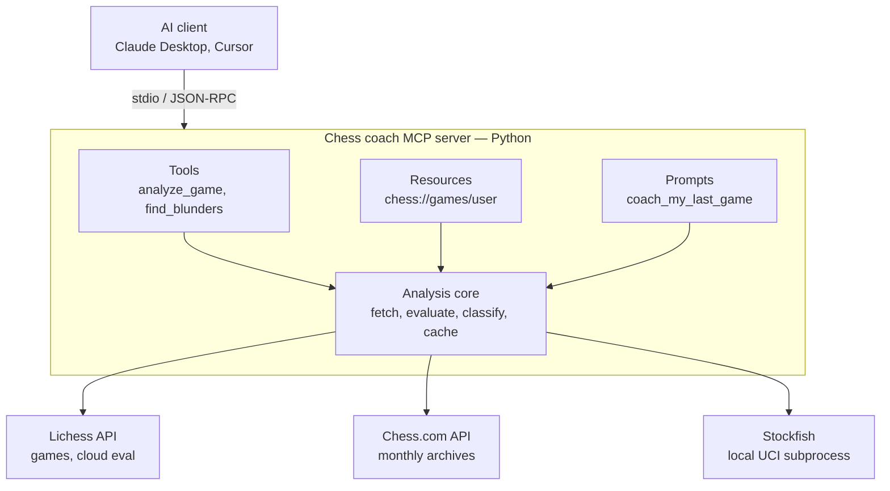

# Chess Coach MCP — Project Plan

An open source MCP server that turns any AI assistant (Claude Desktop, Cursor, etc.) into a chess coach.
It fetches your games from Lichess / Chess.com, analyzes them with Stockfish, and gives the AI structured
data so it can explain *why* you lost — in plain language.

---

## 1. The problem

| Today's option | What's wrong |
|---|---|
| Chess.com Game Review | Limited free uses per day, full version paid |
| Lichess analysis | Free, but only shows numbers (`?? -3.2`), no explanation |
| Human coach | Explains properly, but expensive |

**Gap:** engines tell you *what* was wrong, coaches tell you *why*.
Only the expensive option explains it in words you can learn from.

## 2. What this project solves

1. **Single game review in plain language** — "On move 18 you played Nf3?? Your knight was defending e5..."
2. **Pattern detection across many games** — "You lost 14 of your last 20 games to back-rank tactics."
3. **Conversational** — ask follow-ups: "what should I have played instead?", "show me another game with this mistake."

**Why MCP instead of a website:** the hard part — explaining chess in natural language — is what an LLM is good at.
The MCP just gives the LLM the data (games) and the ground truth (engine evals).

**Who uses it:** anyone rated ~400–2000 playing online who wants to improve without paying.

## 3. Why chess is a good MCP portfolio project

- Uses **all three MCP primitives** naturally (tools, resources, prompts) — most portfolio MCPs only do tools
- Integrates an **external process** (Stockfish via UCI subprocess) + an **external API** (Lichess / Chess.com)
- **Memorable and demo-able** in 30 seconds

## 4. Architecture



**Flow:** client calls a tool → server fetches PGN → each position goes through Stockfish →
moves are classified → structured JSON returned → AI explains it to the user.

**Transport:** stdio (local). No hosting required. Users clone the repo and add one config line.

## 5. Engine design

- **Engine:** Stockfish (free, open source, strongest available)
- **Protocol:** UCI, wrapped by `python-chess` (~5 lines to analyze a position)
- **Install:** auto-download the Stockfish binary on first run; fall back to Lichess cloud-eval API if missing
- **Classification** by centipawn loss (eval before move − eval after move):

| Centipawn loss | Label |
|---|---|
| > 300 | Blunder |
| 100–300 | Mistake |
| 50–100 | Inaccuracy |

- **Performance:** depth 12–14 for bulk scans, depth 18+ for critical moments. Cache every analyzed game in SQLite.

## 6. Project structure

```
chess-coach-mcp/
├── README.md                  # what it does, demo GIF, install, config snippet
├── LICENSE                    # MIT
├── pyproject.toml             # package metadata, deps, entry point
├── .github/
│   └── workflows/ci.yml       # lint + tests on every push
│
├── src/chess_coach_mcp/
│   ├── __init__.py
│   ├── server.py              # creates the MCP server, registers everything, runs stdio
│   │
│   ├── tools/                 # MCP tools (actions the AI can call)
│   │   ├── __init__.py
│   │   ├── games.py           # get_recent_games(username, platform, count)
│   │   ├── analyze.py         # analyze_game(game_id), find_blunders(game_id)
│   │   └── stats.py           # get_opening_stats(username)
│   │
│   ├── resources/             # MCP resources (data the AI reads like files)
│   │   ├── __init__.py
│   │   └── games.py           # chess://games/{user}/recent, chess://game/{id}/pgn
│   │
│   ├── prompts/               # MCP prompt templates
│   │   ├── __init__.py
│   │   └── coach.py           # coach_my_last_game, weekly_review
│   │
│   ├── core/                  # chess logic — NO MCP imports here
│   │   ├── __init__.py
│   │   ├── engine.py          # Stockfish wrapper via python-chess, auto-download
│   │   ├── analysis.py        # eval per move, centipawn loss, blunder classification
│   │   ├── cache.py           # SQLite cache keyed by game_id
│   │   └── models.py          # dataclasses: Game, MoveEval, GameReport
│   │
│   └── clients/               # external API wrappers
│       ├── __init__.py
│       ├── lichess.py         # fetch games (NDJSON), cloud eval fallback
│       └── chesscom.py        # fetch monthly archives
│
├── tests/
│   ├── test_analysis.py       # blunder thresholds on known positions
│   ├── test_clients.py        # mocked API responses
│   └── fixtures/
│       └── sample_game.pgn
│
└── examples/
    └── claude_desktop_config.json   # copy-paste config for users
```

### Two design choices to highlight in the README

1. **`core/` has zero MCP imports.** Tools, resources and prompts are thin wrappers over it.
   Chess logic is testable without an MCP client and reusable in a CLI or web app.
2. **Tools, resources and prompts are separate packages.** Signals you understand the full protocol,
   not just tool calling.

## 7. MCP surface (v1)

### Tools

| Tool | Input | Returns |
|---|---|---|
| `get_recent_games` | `username`, `platform` (lichess/chesscom), `count` | list of `{game_id, opponent, result, opening, date}` |
| `analyze_game` | `game_id` | per-move evals, classification, best line, summary stats |
| `find_blunders` | `game_id` | only moves with centipawn loss > 100, with engine's best move |
| `get_opening_stats` | `username`, `color` | win/loss/draw per opening played |

### Resources

| URI | Content |
|---|---|
| `chess://games/{username}/recent` | JSON list of recent games |
| `chess://game/{game_id}/pgn` | raw PGN text |

### Prompts

| Prompt | Arguments | What it does |
|---|---|---|
| `coach_my_last_game` | `username` | fetch + analyze last game, ask AI to explain the 3 biggest mistakes |
| `weekly_review` | `username` | analyze last 7 days, find recurring patterns |

## 8. Tech stack

- Python 3.11+
- `mcp` (official Python SDK)
- `python-chess`
- `httpx` for API calls
- `sqlite3` (stdlib) for cache
- `pytest`, `ruff`

## 9. Roadmap

- [ ] **v1** — Lichess games, Stockfish analysis, blunder classification, one prompt, README with demo GIF
- [ ] **v1.1** — Chess.com support
- [ ] **v1.2** — Multi-game pattern detection (recurring tactical themes)
- [ ] **v2** — Puzzle suggestions from Lichess puzzle DB based on your weaknesses
- [ ] **v2** — Opening repertoire recommendations via Lichess opening explorer

## 10. Before starting

Search GitHub for `chess mcp` to check what already exists and make sure this adds something new.
Lichess API docs: https://lichess.org/api — Chess.com API docs: https://www.chess.com/news/view/published-data-api
